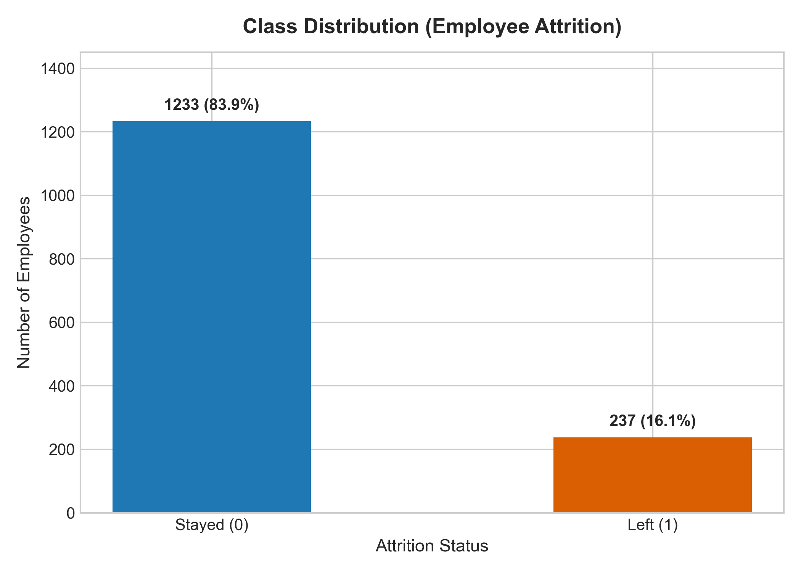
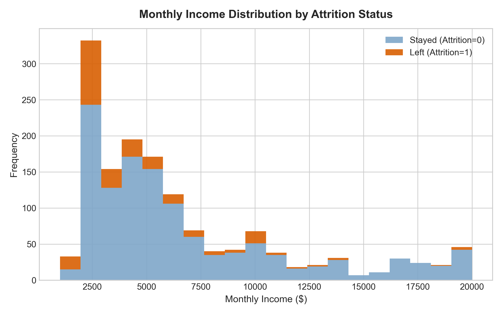
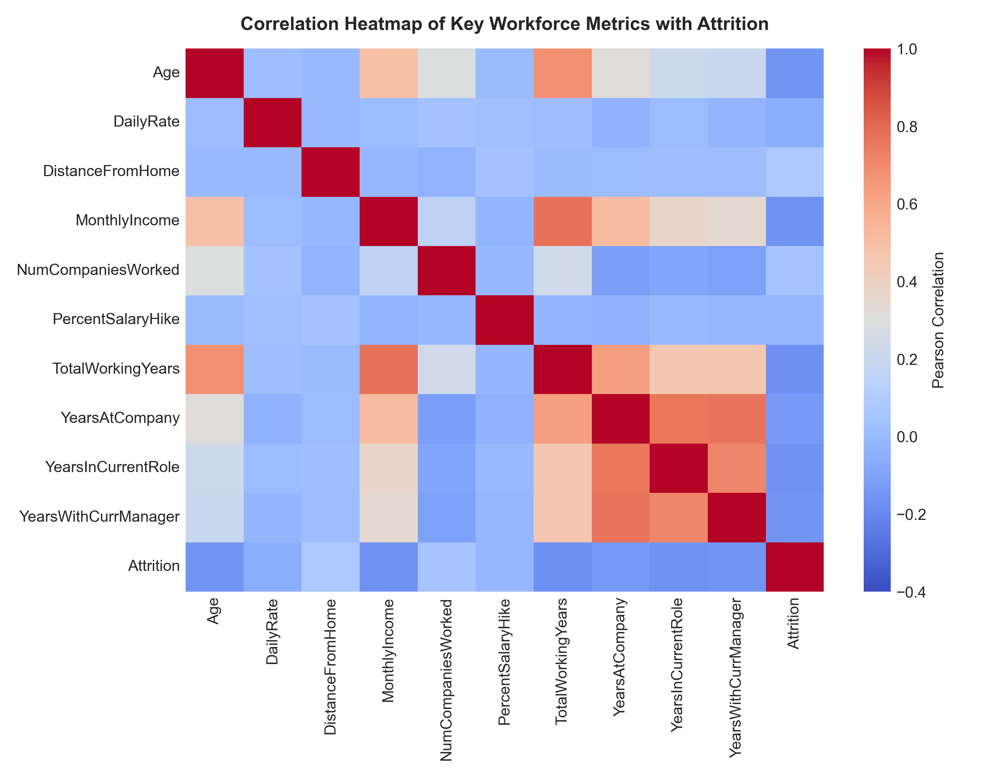
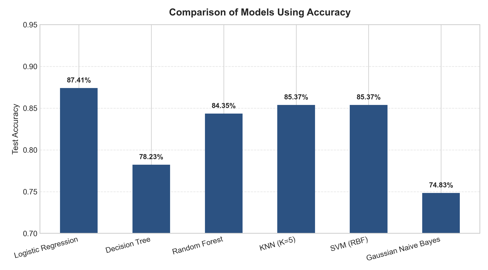
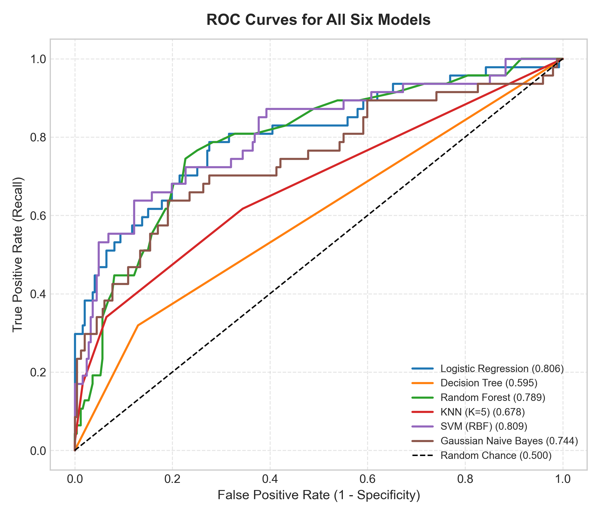
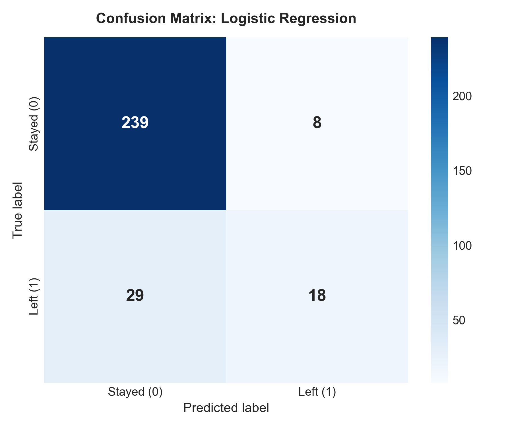
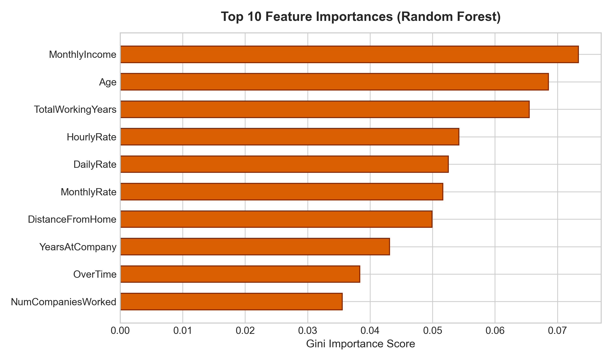
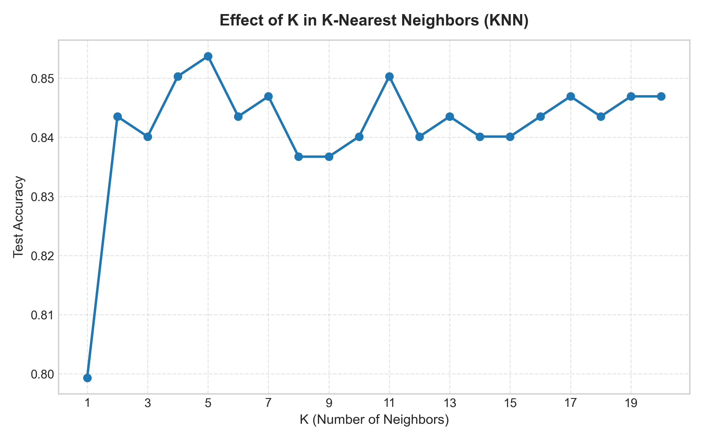

# Employee Attrition Prediction Using Machine Learning
### An End-to-End Supervised Classification Benchmark on Enterprise Workforce Data

[](https://www.python.org/)
[](https://scikit-learn.org/)
[](LICENSE)
[]()

---

## 🏛️ Academic Information

- **Institution:** MNR University — School of Engineering, Technology & Artificial Intelligence
- **Department:** Department of Computer Science & Engineering (Artificial Intelligence & Machine Learning)
- **Course Name:** Machine Learning (Course Code: `25CSM201`)
- **Year & Semester:** 2nd Year, 1st Semester (2-1) | Section: A
- **Lab Practical:** Experiment 30 — End-to-End Machine Learning Solution using a Real-World Dataset
- **Project Guide:** **Dr. M. Praveen**

### 👥 Team Members

| No. | Student Name | University Roll Number | Section | Branch |
|:---:|:---|:---:|:---:|:---|
| 1 | **B. Sam Soloman** | `25RBAIM0021` | A | B. Tech (Hons.) / CSE (AI&ML) |
| 2 | **Thakur Narsingh Singh** | `25RBAIM0027` | A | B. Tech (Hons.) / CSE (AI&ML) |

---

## 📌 Project Overview & Problem Description

Workforce turnover is one of the most critical operational challenges modern enterprises face. Industry research indicates that replacing a departed knowledge worker costs between **50% and 200%** of their annual salary due to recruiting costs, onboarding lag, operational disruption, and loss of institutional knowledge.

### The Problem
Traditional human resource practices rely on **reactive exit interviews** (conducted after a resignation has already been tendered) and **static annual surveys** that fail to capture acute mid-year burnout. Human managers cannot reliably track complex multi-variable interactions across hundreds of employees.

### The Machine Learning Solution
This project develops an **end-to-end supervised machine learning classification framework** capable of predicting employee attrition risk from **30 multifaceted organizational attributes** (spanning demographics, compensation, job role, sentiment scores, and career longevity). 

By evaluating objective workforce signals in real time, the system provides HR leadership with an **advisory decision-support tool** to initiate targeted, supportive retention dialogues before resignations occur.

---

## 📁 Repository Structure

```
Employee-Attrition-Prediction/
│
├── attrition.csv                                # IBM HR Analytics dataset (1,470 records, 35 raw cols)
├── employee_attrition_prediction.py             # Complete, reproducible Python pipeline script
├── Employee_Attrition_Prediction.ipynb          # Interactive Jupyter Notebook with rich visuals & explanations
├── requirements.txt                             # Python dependencies
├── README.md                                    # Comprehensive project documentation
├── DEMO_VIDEO_GUIDE.md                          # Video recording script, recording guide & sharing steps
│
├── Employee_Attrition_Prediction_Report.pdf     # Complete Project Academic Report (38 Pages)
├── Employee_Attrition_Prediction_Report.docx    # Editable Word Document of the Project Report
├── Employee_Attrition_Prediction_Presentation.pptx # 12-Slide PowerPoint Presentation Deck
├── Employee_Attrition_Prediction_Presentation.pdf  # PDF Slide Deck
│
├── data/
│   └── attrition.csv                            # Secondary copy of dataset
│
├── slides/                                      # Rendered presentation slides (PNG)
│   ├── slide_page_39.png
│   ├── slide_page_40.png
│   ├── slide_page_41.png
│   ├── slide_page_42.png
│   ├── slide_page_43.png
│   └── slide_page_44.png
│
└── visualizations/                              # Publication-grade diagnostic charts
    ├── figure_1_class_distribution.png
    ├── figure_2_income_distribution.png
    ├── figure_3_correlation_heatmap.png
    ├── figure_4_model_accuracy_comparison.png
    ├── figure_5_roc_curves.png
    ├── figure_6_confusion_matrix.png
    ├── figure_7_knn_k_sensitivity.png
    └── figure_8_feature_importances.png
```

---

## 📊 Dataset Description

- **Dataset Name:** [IBM HR Analytics Employee Attrition & Performance Dataset](https://www.kaggle.com/datasets/pavansubhasht/ibm-hr-analytics-attrition-dataset)
- **Direct Source:** Public open-access benchmark released by IBM data scientists.
- **Total Records:** 1,470 employees
- **Total Features:** 30 predictive features (after dropping 4 zero-variance constant columns)
- **Target Variable:** `Attrition` (`Yes` = 1 [Churned], `No` = 0 [Retained])
- **Missing Values:** **0** (Dataset is completely verified and clean)

| Property | Value |
|---|---|
| Total Employee Records | **1,470** |
| Retained Employees (Class 0 / No) | **1,233 (83.88%)** |
| Churned Employees (Class 1 / Yes) | **237 (16.12%)** |
| Class Imbalance Ratio | **5.20 : 1** |
| Dropped Constant Columns | `EmployeeCount`, `EmployeeNumber`, `Over18`, `StandardHours` |

### Five Multifaceted Feature Dimensions:
1. **Demographic Profile:** `Age`, `Gender`, `MaritalStatus`, `Education`, `EducationField`
2. **Job Characteristics:** `Department`, `JobRole`, `JobLevel`, `BusinessTravel`, `OverTime`
3. **Compensation Metrics:** `MonthlyIncome`, `DailyRate`, `HourlyRate`, `MonthlyRate`, `PercentSalaryHike`, `StockOptionLevel`
4. **Workplace Sentiment:** `EnvironmentSatisfaction`, `JobSatisfaction`, `RelationshipSatisfaction`, `WorkLifeBalance`, `JobInvolvement`
5. **Work History & Longevity:** `TotalWorkingYears`, `YearsAtCompany`, `YearsInCurrentRole`, `YearsSinceLastPromotion`, `YearsWithCurrManager`, `NumCompaniesWorked`, `TrainingTimesLastYear`

---

## 🤖 Machine Learning Algorithms Benchmarked

Six supervised classification algorithms across distinct inductive learning paradigms were trained and evaluated:

1. **Logistic Regression:**
   - Linear probabilistic model optimizing the log-odds using the sigmoid activation function:
     $$\mathcal{P}(y = 1 \mid \mathbf{x}) = \frac{1}{1 + e^{-(\mathbf{w}^T \mathbf{x} + b)}}$$
   - Optimized via L-BFGS solver with L2 regularization (`max_iter=1000`).

2. **Decision Tree Classifier:**
   - Recursive greedy binary partitioning minimizing Gini impurity:
     $$\text{Gini}(p) = 1 - \sum_{i=1}^{C} p_i^2$$

3. **Random Forest Classifier:**
   - Ensemble bagging architecture combining 100 decorrelated decision trees with random subspace feature sampling (`n_estimators=100`).

4. **K-Nearest Neighbors (KNN, K=5):**
   - Non-parametric lazy learner classifying instances based on majority voting of $K=5$ nearest neighbors under standardized Euclidean distance:
     $$d(\mathbf{x}, \mathbf{x}') = \sqrt{\sum_{i=1}^{d} (x_i - x_i')^2}$$

5. **Support Vector Machine (SVM with RBF Kernel):**
   - Maximum-margin separating hyperplane mapped into infinite-dimensional Hilbert space:
     $$K(\mathbf{x}, \mathbf{x}') = \exp(-\gamma \|\mathbf{x} - \mathbf{x}'\|^2)$$

6. **Gaussian Naive Bayes:**
   - Probabilistic classifier assuming class-conditional feature independence under Gaussian distribution:
     $$\mathcal{P}(x_i \mid y) = \frac{1}{\sqrt{2\pi\sigma^2}} \exp\left(-\frac{(x_i - \mu)^2}{2\sigma^2}\right)$$

### 🛡️ Data Leakage Prevention Architecture
Continuous features are scaled using `StandardScaler` inside Scikit-learn **`Pipeline`** objects. This ensures mean and variance scaling parameters are computed **strictly on training folds**, shielding evaluation data from leakage.

---

## ⚙️ Installation and Execution Guide

### Prerequisites
- Python 3.9, 3.10, 3.11, 3.12, or 3.13 installed.
- Git installed.

### Step 1: Clone the Repository
```bash
git clone https://github.com/your-username/Employee-Attrition-Prediction.git
cd Employee-Attrition-Prediction
```

### Step 2: Create and Activate a Virtual Environment (Optional but Recommended)
```bash
# Windows
python -m venv venv
.\venv\Scripts\activate

# Linux / macOS
python3 -m venv venv
source venv/bin/activate
```

### Step 3: Install Required Dependencies
```bash
pip install -r requirements.txt
```

### Step 4: Run the Complete Machine Learning Pipeline
```bash
python employee_attrition_prediction.py
```

### Step 5: Run the Interactive Jupyter Notebook
```bash
jupyter notebook Employee_Attrition_Prediction.ipynb
```

---

## 📈 Experimental Results & Performance Benchmarks

### Model Benchmark Comparison Table (Held-Out 20% Test Set, 294 Samples)

| Algorithm | 5-Fold CV Acc | Test Accuracy | Precision | Recall | F1-Score | ROC-AUC |
|:---|:---:|:---:|:---:|:---:|:---:|:---:|
| 🏆 **Logistic Regression** | **86.90%** | **87.41%** | **0.6923** | **0.3830** | **0.4932** | **0.8057** |
| **Support Vector Machine (RBF)** | 86.22% | 85.37% | 0.6667 | 0.1702 | 0.2712 | **0.8091** |
| **Random Forest** | 85.88% | 84.35% | 0.5455 | 0.1277 | 0.2069 | 0.7890 |
| **K-Nearest Neighbors (K=5)** | 85.29% | 85.37% | 0.6667 | 0.1702 | 0.2712 | 0.6780 |
| **Decision Tree** | 78.57% | 78.23% | 0.3191 | 0.3191 | 0.3191 | 0.5948 |
| **Gaussian Naive Bayes** | 78.14% | 74.83% | 0.3483 | **0.6596** | 0.4559 | 0.7441 |

> **Champion Model Selected:** **Logistic Regression** achieved the highest test accuracy (**87.41%**), highest balanced F1-score (**0.4932**), and strong cross-validation stability (**86.90%**).

---

## 📊 Publication-Quality Diagnostic Visualizations

### 1. Class Distribution & Monthly Income Histogram
| Figure 1: Class Distribution (83.9% vs 16.1%) | Figure 2: Income Distribution by Attrition |
|:---:|:---:|
|  |  |

### 2. Correlation Matrix Heatmap


### 3. Model Benchmark Accuracy & ROC Curves
| Figure 4: Test Accuracy Comparison | Figure 5: ROC Curves (All 6 Models) |
|:---:|:---:|
|  |  |

### 4. Confusion Matrix & Top 10 Random Forest Drivers
| Figure 6: Confusion Matrix (Logistic Regression) | Figure 8: Top 10 Feature Importances |
|:---:|:---:|
|  |  |

### 5. Hyperparameter Sensitivity (KNN K=1 to 20)


---

## 🎯 Confusion Matrix Detailed Breakdown

On the 294 held-out test employees:
- **True Negatives (TN) = 239**: Employees correctly classified as Stayed.
- **False Positives (FP) = 8**: Employees predicted to leave who actually stayed (low false-alarm rate: 3.2%).
- **False Negatives (FN) = 29**: Departing employees missed by the default threshold.
- **True Positives (TP) = 18**: High-risk churners correctly identified (Precision = 69.23%).

```
Accuracy  = (18 + 239) / 294 = 87.41%
Precision = 18 / (18 + 8)    = 69.23%
Recall    = 18 / (18 + 29)   = 38.30%
F1-Score  = 2 * (P * R) / (P + R) = 0.4932
ROC-AUC   = 0.8057
```

---

## 🔍 Top 10 Organizational Drivers of Turnover

Random Forest Gini importance reveals the primary organizational features driving attrition:
1. **Monthly Income (0.0733)**: Compensation disparity is the single strongest turnover indicator.
2. **Age (0.0686)**: Younger staff display higher mobility; tenured staff display stability.
3. **Total Working Years (0.0655)**: Early-career professionals churn at elevated rates.
4. **Hourly Rate (0.0542)**: Correlated with perceived fairness of compensation.
5. **Daily Rate (0.0525)**: Direct compensation indicator.
6. **Monthly Rate (0.0516)**: Direct financial metric.
7. **Distance From Home (0.0499)**: Longer commutes strongly escalate turnover risk.
8. **Years At Company (0.0431)**: Inflection points occur in the first 1–3 years.
9. **OverTime (0.0384)**: Frequent mandatory overtime leads to acute burnout.
10. **Num Companies Worked (0.0355)**: Historical mobility predicts future mobility.

---

## 💻 Real-Time Single Employee Inference Demonstration

```text
Sample Employee Profile (From Test Set):
  • Age                     : 33
  • Monthly Income          : $3,348
  • Total Working Years     : 10
  • Years at Company        : 10
  • OverTime (1=Yes, 0=No)  : 1 (Yes)
  • Distance From Home (mi) : 13

Inference Result:
  • Predicted Outcome       : Left (Attrition = 1)
  • Churn Probability       : 74.72%
  • Ground Truth Status     : Left (Attrition = 1)
  • Match Assessment        : CORRECT PREDICTION
```

---

## 🎥 Project Presentation & Demo Video

- **Presentation Slide Deck (PowerPoint):** [`Employee_Attrition_Prediction_Presentation.pptx`](./Employee_Attrition_Prediction_Presentation.pptx)
- **Presentation Slide Deck (PDF):** [`Employee_Attrition_Prediction_Presentation.pdf`](./Employee_Attrition_Prediction_Presentation.pdf)
- **Comprehensive Project Report (PDF):** [`Employee_Attrition_Prediction_Report.pdf`](./Employee_Attrition_Prediction_Report.pdf)
- **Demo Video Recording Script & Guide:** [`DEMO_VIDEO_GUIDE.md`](./DEMO_VIDEO_GUIDE.md)
- **Demo Video Link:** [Click to Watch Demo Video on YouTube](https://youtu.be/your-video-id) *(Please update with your unlisted YouTube or public Google Drive link)*

---

## ⚖️ Ethical Governance & Practical Recommendations

1. **Advisory Decision Support:** Model outputs must serve solely as early indicators to initiate supportive, empathetic check-ins, **never** for punitive action, compensation cuts, or automated termination.
2. **Privacy First:** Modeling should rely on aggregate, consensual enterprise attributes, completely avoiding invasive surveillance of private employee communications.
3. **Algorithmic Parity:** Protected demographics (Gender, MaritalStatus) must be audited continuously to avoid perpetuating legacy corporate biases.

---

## 📜 Academic Declaration

We hereby declare that this mini-project entitled **"Employee Attrition Prediction Using Machine Learning"** is our original work submitted for the Machine Learning Laboratory (Course Code: `25CSM201`) at MNR University.

- **B. Sam Soloman** (`25RBAIM0021`)
- **Thakur Narsingh Singh** (`25RBAIM0027`)
